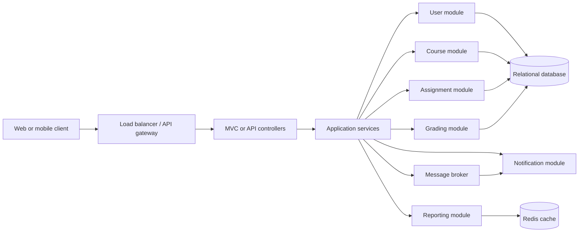
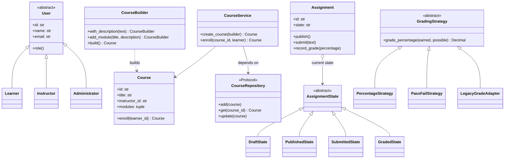

# EdTech LMS: Low-Level Design Capstone..

This repository is a runnable Python reference implementation of a modular learning management system. It demonstrates domain modeling, SOLID boundaries, nine design patterns, role-protected assignment workflows, grading, event-driven notifications, and reporting. The implementation uses only the Python standard library and in-memory repositories so the design can be studied without a database or external service account.

## Run It

Requires Python 3.11 or newer. From the repository root:

```powershell
python -m unittest discover -v
python -m lms
```

The CLI demo builds and enrolls in a course, publishes an assignment, submits work, sends a notification, grades the submission, and prints a course summary.

## Project Structure

```text
lms/
  assignments/   Assignment aggregate, lifecycle state, authorization
  core/          Settings singleton and thread-safe event bus
  courses/       Course builder, repository contract, and course service
  grading/       Grading strategies, legacy adapter, grading service
  notifications/ Channel bridge, factory, SMS adapter, observers
  reports/       Read-only course summary
  users/         User hierarchy and repository
tests/           Standard-library unit tests
docs/            Walkthrough recording script
```

## Problem and Scope

An LMS combines independent user, content, assignment, assessment, notification, and reporting concerns. Putting these rules into a single controller couples business logic to storage and delivery choices, makes grading extensions risky, and complicates tests. This design separates the domain from its infrastructure interfaces and keeps examples executable in one local process.

This is a learning/reference application, not a production deployment. Persistence is in memory; email, SMS, authentication, payment, and distributed infrastructure are represented by replaceable boundaries rather than live integrations.

## User Stories and Functional Requirements

| ID    | User story                                                                            | Acceptance behavior                                                                    |
| ----- | ------------------------------------------------------------------------------------- | -------------------------------------------------------------------------------------- |
| US-01 | As an instructor, I want to create a course with an optional description and modules. | The builder validates required fields and returns a course with immutable module data. |
| US-02 | As a learner, I want to enroll in a course.                                           | Enrollment is recorded once and can be summarized in reports.                          |
| US-03 | As an instructor, I want to publish an assignment.                                    | Only an instructor can move an assignment from draft to published.                     |
| US-04 | As a learner, I want to submit work to a published assignment.                        | Only a learner can submit non-empty work; a submission event is emitted.               |
| US-05 | As an instructor, I want to grade submitted work.                                     | Pluggable grading strategies produce a grade; invalid lifecycle transitions fail.      |
| US-06 | As a learner, I want confirmation when a submission is received.                      | An observer handles the domain event and a factory-selected channel delivers it.       |
| US-07 | As an administrator, I want a quick course/enrollment summary.                        | The report service returns catalog and enrollment counts.                              |

## Quality Requirements

- Maintainability: business use cases depend on repository and delivery abstractions, not concrete infrastructure.
- Testability: constructors accept collaborators; in-memory repositories and delivery gateways are deterministic test doubles.
- Security: role checks are applied at the application-service boundary; production authentication and identity verification remain external requirements.
- Performance: indexed repository lookups are O(1) on average; report generation is O(number of courses + enrollments scanned).
- Concurrency: in-memory repositories, event subscriptions, and assignment state transitions use locks. A multi-process deployment must move consistency to transactional storage.
- Scalability: stateless API/service instances can scale behind a load balancer; cache-aside and event broker guidance is below.

## Architecture

The executable sample uses a layered, modular-monolith structure. Modules can later be extracted into services without changing their domain-facing contracts.



The current code implements domain and application layers plus in-memory adapters. An HTTP/MVC controller, database adapter, Redis client, and message broker are deliberate extension points, not claimed features of the demo.

### Cache-Aside Sketch

```text
course = cache.get(course_id)
if course is a miss:
    course = repository.get(course_id)
    cache.set(course_id, course, ttl=60 seconds)
return course

on course update:
    repository.save(course)
    cache.delete(course.id)  # invalidate after commit
```

Cache public course metadata with a short TTL; do not cache authorization decisions or private submissions without strict tenant/user keys. Use invalidation after successful writes, monitor hit rate and staleness, and avoid caching data whose correctness depends on an uncommitted transaction.

### Load and Concurrency

- Put stateless HTTP/API instances behind a health-checked load balancer; sessions and durable state belong in shared services, not process memory.
- Scale reads using database indexes and replicas where the consistency model allows; scale report workloads asynchronously or from pre-aggregated views.
- The in-memory `RLock`s prevent local races only. In a distributed deployment, use database transactions, unique constraints, optimistic version columns, and an idempotency key for submissions.
- Publish notifications through a durable broker/outbox after the submission transaction commits. Consumers should be idempotent and retry transient delivery failures.
- Bound worker pools and apply timeouts/back-pressure around external email/SMS providers. Do not hold database transactions open while sending notifications.

## UML Class Diagram



## SOLID and OOP Mapping

| Principle     | Application                                                                                                                   |
| ------------- | ----------------------------------------------------------------------------------------------------------------------------- |
| Encapsulation | `Assignment` owns its state and synchronizes lifecycle changes; `Course` is immutable and enrollment returns a replacement.   |
| Abstraction   | `User`, `GradingStrategy`, `NotificationChannel`, and repository protocols define stable contracts.                           |
| Inheritance   | `Learner`, `Instructor`, and `Administrator` specialize the abstract `User`; grading/channel variants implement abstractions. |
| Polymorphism  | `GradingService` invokes any `GradingStrategy`; `NotificationSender` works with any channel.                                  |
| SRP           | Course authoring, persistence, grading, event dispatch, notification delivery, and reporting each have separate owners.       |
| OCP           | New grading rules and notification channels implement existing abstractions without modifying their callers.                  |
| LSP           | Strategy and channel implementations preserve their base contracts and validation behavior.                                   |
| ISP           | `CourseRepository` and gateway contracts expose only the methods their clients need.                                          |
| DIP           | `CourseService` accepts `CourseRepository`; grading and notification services accept abstractions through constructors.       |

## Pattern-to-Problem Mapping

| Pattern                | Problem it solves                                                            | Why it fits                                                                    | Alternative considered                                                                          |
| ---------------------- | ---------------------------------------------------------------------------- | ------------------------------------------------------------------------------ | ----------------------------------------------------------------------------------------------- |
| Singleton (creational) | Multiple independent settings objects can disagree.                          | `LMSSettings` supplies one process-wide default configuration instance.        | Explicit immutable settings object; preferable when multiple tenants/configurations are needed. |
| Factory (creational)   | Callers should not know how a channel sender is selected.                    | `NotificationFactory` resolves configured channels by name.                    | Direct dependency injection when the channel is fixed at startup.                               |
| Builder (creational)   | Course constructors become unwieldy as optional modules/details grow.        | `CourseBuilder` validates and assembles a course fluently.                     | A large keyword-only constructor for a small stable model.                                      |
| Adapter (structural)   | Legacy SMS API does not match the channel contract.                          | `LegacySmsChannelAdapter` translates the new notification call to `send_text`. | Replace the legacy provider if migration cost is acceptable.                                    |
| Bridge (structural)    | Notification policy should not be coupled to delivery technology.            | `NotificationSender` delegates to an independent `NotificationChannel`.        | Separate subclasses for every policy/channel pair, which multiply combinations.                 |
| Decorator (structural) | Role authorization should wrap use cases without embedding repeated checks.  | `@require_role` composes role policy around service operations.                | Middleware/policy engine for a full HTTP application.                                           |
| Observer (behavioral)  | Submission flow should not depend on notification delivery.                  | `EventBus` publishes typed events to independently subscribed observers.       | Direct call for a tiny synchronous prototype; broker/outbox at production scale.                |
| Strategy (behavioral)  | Grading algorithms vary by course or assessment.                             | `GradingService` can receive percentage, pass/fail, or adapted legacy grading. | Conditional branches, which grow as grading modes are added.                                    |
| State (behavioral)     | Assignment rules vary across draft, published, submitted, and graded phases. | State objects make invalid transitions explicit and testable.                  | Enum plus conditional logic for a very small, stable lifecycle.                                 |

## Refactoring and Anti-Patterns

These are representative smells the design explicitly avoids, rather than claims about a supplied legacy repository (none was provided).

### 1. God Service / Shotgun Responsibility

Before:

```python
class LMSManager:
    def create_course_and_email_students(self, data):
        # validate input, write SQL, enroll users, format email, send email, log
        ...
```

After: `CourseService` owns course use cases, repository adapters own persistence, and notification observers own delivery. Adding a new notification channel no longer changes course creation.

### 2. Conditional Grading / OCP Violation

Before:

```python
def grade(score, maximum, mode):
    if mode == "percentage":
        return score / maximum * 100
    if mode == "pass_fail":
        return 100 if score / maximum >= 0.6 else 0
```

After: `GradingService` delegates to a `GradingStrategy`. Adding a policy creates a new strategy, while legacy compatibility is isolated in `LegacyGradeAdapter`.

### 3. Boolean Lifecycle Flags / Invalid States

Before: `is_published`, `is_submitted`, and `is_graded` can all be true at once. After: `AssignmentState` accepts only legal transitions; an invalid transition raises `InvalidStateTransition`.

| Smell reduced       | Design change                                          | Expected quality effect                                                  |
| ------------------- | ------------------------------------------------------ | ------------------------------------------------------------------------ |
| God service         | Split application and infrastructure responsibilities. | Smaller units to review and mock; unrelated changes touch fewer modules. |
| Conditional grading | Strategy plus adapter.                                 | Add policies without editing the grading workflow; isolated unit tests.  |
| Contradictory flags | Explicit lifecycle states.                             | Invalid transitions fail at the point of change.                         |

These are qualitative design outcomes, not benchmark claims. Runtime performance should be measured with representative data before optimization.

## Testability and Test Coverage

Run `python -m unittest discover -v`. Tests cover builder validation, course enrollment and repository behavior, RBAC, lifecycle transitions, strategy/adapter grading, observer delivery, channel factory/bridge, singleton identity, and reporting. External gateways and storage are constructor-injected so tests can replace them without network or database setup.

## Video Walkthrough

The ready-to-record 10-12 minute narration and demo sequence is in [docs/walkthrough.md](docs/walkthrough.md). A video file is not included; record the script with Loom, OBS, or another screen recorder.
